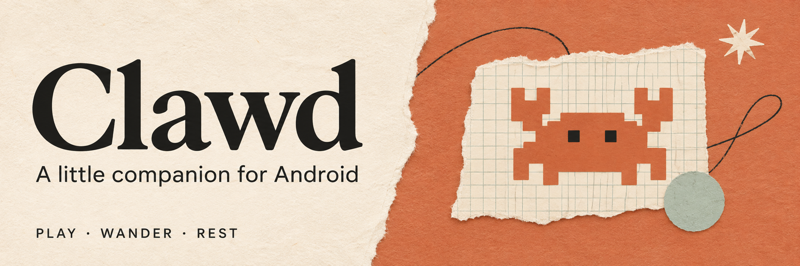

<p align="center">
  
</p>

<p align="center">
  <strong>Немного характера на твоём экране.</strong><br>
  Пиксельный питомец, который гуляет, играет и засыпает рядом.
</p>

<p align="center">
  <a href="https://github.com/FASTDROPX/Clawd/releases/tag/v0.5.1-beta"></a>
  
  
</p>

<p align="center">
  <a href="#знакомься-clawd">Возможности</a> ·
  <a href="#установка">Установка</a> ·
  <a href="#разрешения">Разрешения</a> ·
  <a href="#сборка">Сборка</a> ·
  <a href="https://github.com/FASTDROPX/Clawd/issues">Обратная связь</a>
</p>

---

## Знакомься, Clawd

Clawd живёт поверх приложений Android. Его можно перетаскивать, гладить и угощать, а он отвечает движениями, эмоциями и короткими репликами. Внешность и поведение настраиваются в Material-интерфейсе с динамическими цветами.

| Играй | Настраивай | Наблюдай |
| :--- | :--- | :--- |
| Перетаскивай, подбрасывай и гладь питомца. | Шесть расцветок и три размера. | Гуляет сам и засыпает после бездействия. |
| Угощай и возвращай в центр экрана. | Гравитация, реакции на тряску и режим сна. | Танцует, когда на устройстве играет музыка. |
| Создавай ручные опоры в приложениях. | Размытие, пыль, след и эффекты ударов. | Реагирует на уведомления поддерживаемых клиентов Telegram. |

### Маленькие привычки

- **Два касания** — прыжок.
- **Удержание и движение** — погладить.
- **Резкое перетаскивание** — бросить.
- **Исключения** — выбери приложения, в которых питомец должен прятаться.
- **Опоры** — клавиатура, элементы Clawd, ручные позиции и доступные элементы других приложений.

## Установка

1. Открой [релиз 0.5.1-beta](https://github.com/FASTDROPX/Clawd/releases/tag/v0.5.1-beta) и скачай **Clawd.apk**.
2. Установи APK. Если Android попросит, разреши установку из выбранного браузера или файлового менеджера.
3. Открой Clawd, нажми **«Показать питомца»** и разреши отображение поверх других приложений.
4. Включи дополнительные возможности и дай им нужные разрешения по желанию.

**Версии:** готовый APK — **0.5.1-beta / code 11**; исходники в `main` — **0.5.2-beta / code 12**. APK предоставлен отдельно и опубликован без пересборки. Соответствие этого APK исходникам 0.5.2 не заявляется. Подробности и SHA-256 — в [описании билда](docs/BUILD.md).

Нужен Android 8.0 или новее. Исходный проект настроен на `arm64-v8a` и `x86_64`; состав готового APK указан в описании билда.

## Разрешения

| Доступ | Для чего нужен |
| :--- | :--- |
| Поверх других приложений | Показывать интерактивного питомца. |
| Уведомления | Постоянное уведомление с управлением и кнопкой скрытия. |
| Данные об использовании | Определять приложение для исключений и ручных опор. |
| Специальные возможности | Находить координаты видимых элементов для автоматических опор. |
| Доступ к уведомлениям | Реагировать на входящие сообщения поддерживаемых клиентов Telegram. |
| Работа без ограничений батареи | Помочь Android сохранять питомца в фоне; зависит от производителя устройства. |

Для базового питомца достаточно доступа поверх приложений. Остальные разрешения относятся к соответствующим дополнительным функциям. Android выдаёт доступ к уведомлениям целиком; обработчик в исходниках фильтрует их по клиенту и категории сообщения.

В исходном манифесте нет разрешения `INTERNET`. Подробнее о локальной обработке — [PRIVACY.md](PRIVACY.md).

## Что учитывать в бете

- Реакции Telegram в исходниках поддерживают `org.telegram.messenger`, `org.telegram.messenger.web`, `org.thunderdog.challegram` и `com.exteragram.messenger`. Клиенты с другими именами пакетов не обрабатываются.
- Опоры зависят от того, какие элементы приложение предоставляет Android Accessibility. Не каждый нарисованный элемент доступен как опора.
- Проверка исключений выполняется периодически; при смене приложения возможна короткая задержка скрытия.
- Присланный APK подписан отладочным сертификатом. Обновление поверх другой сборки возможно только при совпадении подписи.
- Сборка и проверка на устройстве при публикации не выполнялись.

## Сборка

Потребуются **JDK 17 или 21**, **Android SDK Platform 36**, **Build-Tools 35.0.0** и **Python 3.12** в `PATH`. Укажи SDK через `ANDROID_HOME` или локальный `local.properties`.

```sh
git clone https://github.com/FASTDROPX/Clawd.git
cd Clawd
```

Linux / macOS:

```sh
chmod +x gradlew
./gradlew assembleDebug
```

Windows:

```powershell
.\gradlew.bat assembleDebug
```

Результат: `app/build/outputs/apk/debug/app-debug.apk`. Первая сборка скачивает зависимости. Эта команда собирает версию исходников **0.5.2-beta**, а не воспроизводит опубликованный APK 0.5.1-beta. Локальная debug-подпись может отличаться от подписи релиза.

## Внутри проекта

```text
app/src/main/
├── java/com/clawd/pet/   # интерфейс, оверлей, эффекты, интеграции Android
├── python/clawd.py      # физика, состояния, спрайты и реакции
└── res/                 # темы, анимации, иконки и Rubik
```

**Java + Python · Chaquopy · Material Components · Gradle Wrapper 8.13**

## Авторство

Питомец адаптирован из **clawd_pet 1.5 от @itskotovski** — исходное указание авторства сохранено. Rubik распространяется по [SIL Open Font License](OFL-Rubik.txt). Остальные сведения — в [NOTICE.md](NOTICE.md).

Независимый проект сообщества; не официальный продукт Anthropic. Обложка создана с помощью ИИ для этого репозитория по визуальным референсам и является иллюстрацией, а не скриншотом приложения.

<p align="center"><sub>Clawd — маленький компаньон, которому достаточно уголка экрана.</sub></p>
